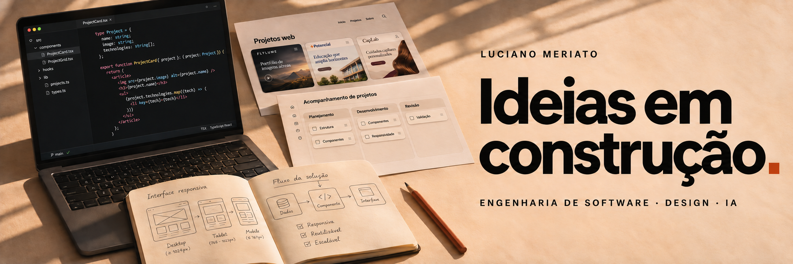

  <a href="#projetos-selecionados">Projetos</a> &nbsp; / &nbsp;
  <a href="#tecnologias">Tecnologias</a> &nbsp; / &nbsp;
  <a href="#inteligência-artificial">Inteligência artificial</a>

## Da ideia à experiência.

Sou **Luciano Meriato**, mas pode me chamar de **Juca**. Estudo Engenharia de Software na **FIAP** e gosto de conectar interfaces, lógica e criatividade para construir produtos que resolvam necessidades reais.

Meus projetos são uma forma de explorar tecnologia na prática: de experiências 3D no navegador a aplicações com autenticação, dados e inteligência artificial.

## Projetos selecionados

### 01 · FLYLUME

Na FLYLUME, apliquei tecnologia para transformar um portfólio de filmes aéreos em uma experiência interativa.

- **3D no navegador:** Three.js e React Three Fiber para renderizar o drone; GSAP e Lenis para coordenar o movimento da cena com a rolagem da página.
- **Desempenho adaptativo:** detecção de capacidade gráfica para ajustar a complexidade do 3D e usar uma imagem estática nos aparelhos em que a cena seria pesada.
- **Estrutura do site:** Next.js e TypeScript, com dados de vídeos e serviços separados dos componentes para facilitar a atualização do portfólio.

### 02 · +Potencial

No site da +Potencial, usei o frontend para organizar a apresentação da escola e conduzir a navegação até o contato.

- **Componentização:** Next.js e React para separar metodologia, trilhas de estudo, modalidades, professores e FAQ em seções reutilizáveis.
- **Interface responsiva:** TypeScript e Tailwind CSS na construção dos componentes e na adaptação do layout a diferentes telas.
- **Movimento e navegação:** Framer Motion para as animações da interface e acesso ao WhatsApp integrado à jornada de contato.

[Ver código ↗](https://github.com/LucianoMeriato/site-potencial)

### 03 · Cartório — 1º Ofício

No site do cartório de Patrocínio/MG, apliquei desenvolvimento web para tornar informações e serviços mais fáceis de encontrar.

- **Conteúdo estruturado:** serviços, documentos e perguntas frequentes organizados em módulos de dados, separados da interface.
- **Modelagem com TypeScript:** definição dos campos de cada serviço, como título, descrição, ícone e destino de navegação, para manter consistência ao atualizar o conteúdo.
- **Interface em React:** componentes reutilizáveis, Tailwind CSS para o layout responsivo e Vite no ambiente de desenvolvimento e na geração da versão de produção.

[Ver código ↗](https://github.com/LucianoMeriato/cartorio-site)

### 04 · Achadinhos Avya

No Avya, construí uma interface para descobrir e acessar os grupos de ofertas por interesse.

- **Busca e filtros:** seleção por categoria e busca textual por nome, categoria e descrição, executadas diretamente no navegador.
- **Dados e lógica:** configuração tipada dos grupos em TypeScript; categorias derivadas dos próprios dados e filtros organizados em hooks com `useMemo`.
- **Experiência de uso:** React, Tailwind CSS e Framer Motion para uma interface pensada para o celular, com adaptação à preferência de reduzir movimento.

### 05 · CapLab

Criei o CapLab para a Ana acompanhar os cuidados com o cabelo. O projeto reúne interface, dados e IA em uma aplicação com histórico pessoal.

- **Conta e persistência:** Next.js e Firebase para autenticação e armazenamento do diário, questionários, fotos e registros de cortes, com acesso vinculado à usuária.
- **IA integrada ao produto:** chamadas à OpenAI pelo servidor para descrever características visíveis das fotos e organizar sugestões de cuidados a partir das informações fornecidas.
- **Validação e controle de uso:** respostas estruturadas verificadas com Zod, credenciais mantidas no servidor e transações no Firestore para limitar chamadas e evitar pedidos duplicados.

## Tecnologias

**Interfaces** &nbsp; `TypeScript` `JavaScript` `React` `Next.js` `Tailwind CSS`

**3D e movimento** &nbsp; `Three.js` `React Three Fiber` `GSAP` `Framer Motion`

**Backend e dados** &nbsp; `Node.js` `Python` `Java` `SQL` `PostgreSQL` `Firebase`

**IA e ferramentas** &nbsp; `OpenAI API` `Zod` `Git` `GitHub` `Vercel`

## Inteligência artificial

Gosto muito de **inteligência artificial** e estou sempre aprendendo um pouco mais sobre seus modelos, ferramentas e aplicações. Acredito que essas tecnologias já são muito úteis e terão um papel ainda maior no futuro. Por isso, gosto de experimentar, entender como funcionam e explorar maneiras de aplicá-las nos meus projetos.

Tenho aprofundado meus estudos em **APIs, arquitetura de software e integração entre sistemas**, conectando esse aprendizado ao que construo.

---

  Luciano Meriato &nbsp; · &nbsp; São Paulo, Brasil &nbsp; · &nbsp; Engenharia de Software / FIAP

